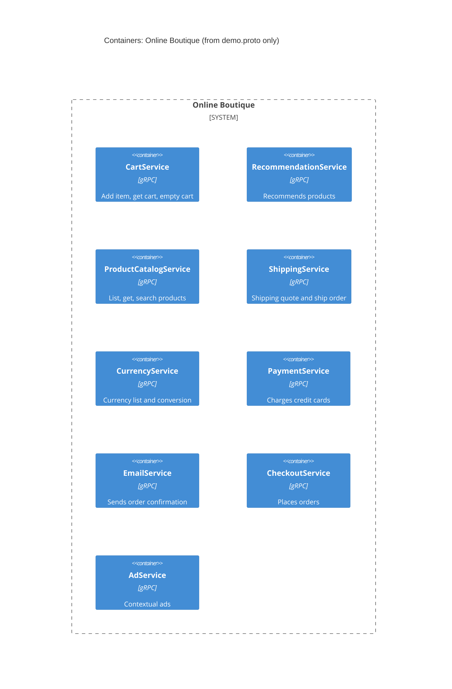

# Task 1, Run A: Recovered architecture (evidence: `demo.proto` only)

## 1. Agent

Claude Code (CLI), model Claude Sonnet 5.5 (`claude-sonnet-5-5`).

## 2. Files read

- `prompts/1-recover-architecture.md` (task file)
- `system/online-boutique/protos/demo.proto` (the only evidence file)

## 3. Containers table

Each gRPC `service` block in the proto implies one service that implements it. This is **[Inferred]**: the proto defines interfaces, not deployed units.

| Container | Technology / language | Responsibility | Evidence |
|---|---|---|---|
| CartService | gRPC (protobuf). Implementation language: Not evidenced in the provided files | Add item, get cart, empty cart per `user_id` | `demo.proto` (`service CartService`: `AddItem`, `GetCart`, `EmptyCart`) |
| RecommendationService | gRPC. Language: Not evidenced | Returns recommended product IDs for a user | `demo.proto` (`service RecommendationService`: `ListRecommendations`) |
| ProductCatalogService | gRPC. Language: Not evidenced | List, get and search products | `demo.proto` (`service ProductCatalogService`: `ListProducts`, `GetProduct`, `SearchProducts`) |
| ShippingService | gRPC. Language: Not evidenced | Shipping quote and ship order (returns tracking ID) | `demo.proto` (`service ShippingService`: `GetQuote`, `ShipOrder`) |
| CurrencyService | gRPC. Language: Not evidenced | List supported currencies, convert `Money` | `demo.proto` (`service CurrencyService`: `GetSupportedCurrencies`, `Convert`) |
| PaymentService | gRPC. Language: Not evidenced | Charge a credit card, returns `transaction_id` | `demo.proto` (`service PaymentService`: `Charge`) |
| EmailService | gRPC. Language: Not evidenced | Send order confirmation email | `demo.proto` (`service EmailService`: `SendOrderConfirmation`) |
| CheckoutService | gRPC. Language: Not evidenced | Place an order (`PlaceOrder`) | `demo.proto` (`service CheckoutService`: `PlaceOrder`) |
| AdService | gRPC. Language: Not evidenced | Returns contextual ads from `context_keys` | `demo.proto` (`service AdService`: `GetAds`) |

Only `go_package` appears in the proto (`option go_package`). It names a Go package for generated code and does not show the language of any service.

## 4. Dependencies table

| Caller → Callee | Protocol | Evidence |
|---|---|---|
| None can be established | n/a | Not evidenced in the provided files |

The proto declares what each service offers, not who calls it. Message shapes hint at possible relationships, but a shared message type is not a runtime call. For example, `CartItem` is used by `ShippingService`, `CartService` and `OrderResult`; `PlaceOrderRequest` carries `CreditCardInfo` and `email`, which match the `PaymentService` and `EmailService` inputs. These hints are **[Inferred]** only and are not drawn as dependencies.

## 5. Mermaid diagram

The diagram matches the tables: nine containers and no `Rel`. I left out the end user and any external systems because the proto does not show them.

## 6. Gaps

| Gap | Extra file that would settle it |
|---|---|
| Who calls whom (all runtime dependencies, including whether `CheckoutService` calls cart, catalog, shipping, currency, payment and email) | `system/online-boutique/kubernetes-manifests/*.yaml` (`*_SERVICE_ADDR` env vars) or the `checkoutservice` source |
| Web frontend and the end user (no service in the proto serves HTTP) | `kubernetes-manifests/frontend.yaml` |
| Data stores (e.g. where `CartService` keeps carts) and message brokers | `kubernetes-manifests/cartservice.yaml` and `redis.yaml`, or the service source |
| Implementation language and framework per service | Each service's source folder or Dockerfile under `system/online-boutique/src/` |
| External systems (e.g. any payment or email provider) | Service source for `paymentservice` and `emailservice` |
| Whether each `service` is a separately deployed container | Kubernetes manifests |
| Any services that exist but have no proto (e.g. a load generator) | `kubernetes-manifests/` listing |
